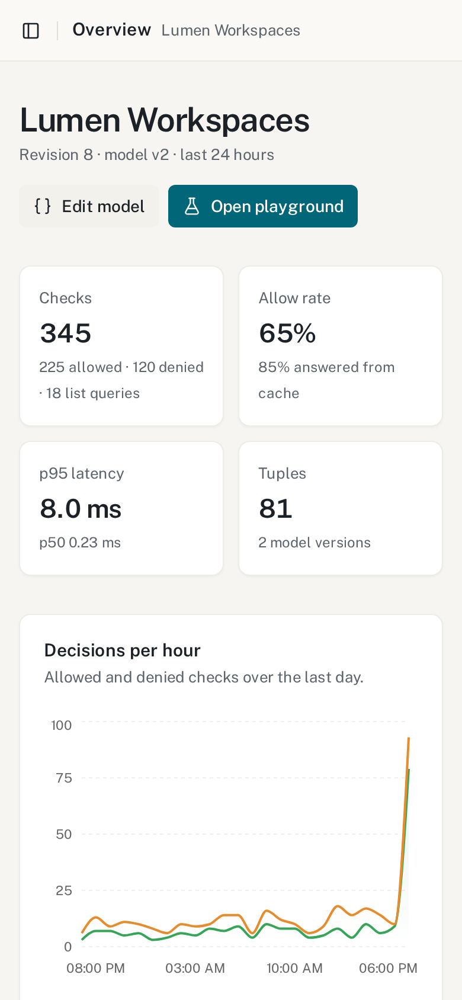
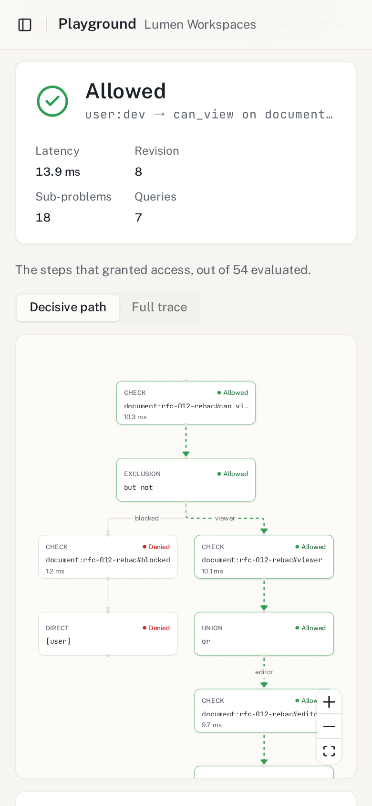
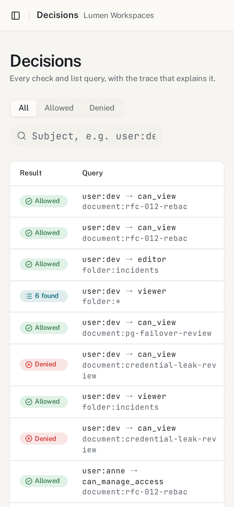
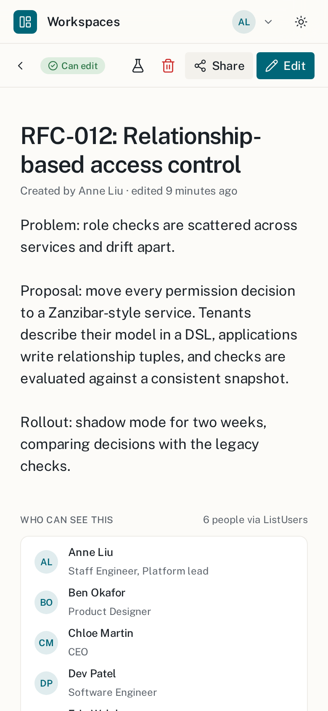
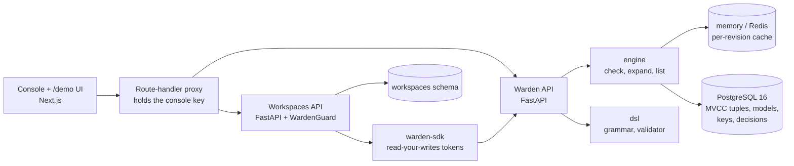

<div align="center">

# Warden

**Zanzibar-style authorization you can read.** Write a model in a small DSL, store relationship tuples,<br>
ask `check`, `expand` and `list-objects`, and see the exact path behind every allow or deny.

[](backend/pyproject.toml)
[](backend/migrations)
[](web)
[](mypy.ini)
[](LICENSE)

<br>

<picture>
  <source media="(prefers-color-scheme: dark)" srcset="docs/screenshots/playground-allowed-dark.png">
  <source media="(prefers-color-scheme: light)" srcset="docs/screenshots/playground-allowed-light.png">
  
</picture>

<sub><code>user:dev</code> can view <code>document:rfc-012-rebac</code>. Each node is a step the evaluator took; the highlighted edges are the decisive path, past <code>but not blocked</code>, through the <code>viewer</code> union and on to inheritance via <code>viewer from parent</code>.</sub>

</div>

## Why this exists

Most products start with `if user.role == "admin"` and end with permission logic spread across
a dozen services, each with a slightly different idea of who can see what. Google's
[Zanzibar paper](https://research.google/pubs/zanzibar-googles-consistent-global-authorization-system/)
describes the alternative: model permissions as relationships, keep those relationships in one
place, and answer every "can X do Y to Z?" from a consistent snapshot. OpenFGA and SpiceDB brought
that design to the rest of the industry.

Warden is a compact, readable implementation of the same ideas. It covers the parts that make
Zanzibar hard: a typed modelling language, snapshot reads with consistency tokens (the
"new enemy" problem), recursive evaluation that survives cycles, and reverse lookups. It also
covers the part that is usually missing: **an explanation**. Every decision is logged with the
trace that produced it, and the console draws that trace as a graph.

It ships with **Workspaces**, a small document-sharing app (orgs, teams, folders, documents)
that hands every permission decision to Warden through a typed Python SDK. You can switch users
and watch the answers change.

## What it does

- **A real DSL.** A Lark grammar with direct types (`[user, team#member, user:*]`), computed
  usersets, `or` / `and` / `but not` and tuple-to-userset (`viewer from parent`). It parses into
  frozen Pydantic AST models; the validator reports errors with line and column.
- **Versioned models.** Each store keeps an append-only list of model versions. Writes and checks
  can pin a `model_id` and default to the latest.
- **Snapshot reads.** Every write bumps the store revision and stamps tuples with
  `created_revision` / `deleted_revision`, so any retained revision can be read without holding a
  transaction open. Writes return a `zk1.` consistency token; reads accept `minimize_latency`,
  `at_least_as_fresh`, `at_exact_snapshot` or `fully_consistent`.
- **Concurrent recursive check.** Sub-problems run concurrently and are shared, unions stop at the
  first grant, and cycles are resolved by iterating to a least fixpoint, bounded by a depth limit
  and a deadline.
- **Explain traces and a decision log.** `check` returns a typed trace tree. Every check and list
  query is logged asynchronously with its trace, latency, revision and API key.
- **Expand, ListObjects, ListUsers, contextual tuples, batch check**, a per-revision cache
  (memory or Redis) that never needs invalidation, and hashed, scoped API keys.
- **Console.** Next.js, a Monaco DSL editor with live validation markers, a tuple browser with
  change history, a playground that draws check and expand results with React Flow, and decision
  charts.

## Screenshots

| | |
|---|---|
|  |  |
| **Overview.** Decisions per hour, allow rate, p95 latency and tuples per type. | **Why denied.** In `viewer but not blocked` the subtracted side matched. |
|  |  |
| **DSL editor.** Semantic errors appear inline at their line and column. | **Decision log.** Every check is stored with its revision, model, latency and trace. |
|  |  |
| **Workspaces demo.** Folders come from ListObjects, "Who can see this" from ListUsers. | **Blocked.** "See why" opens the denying trace in the console. |

On a phone the console and the demo collapse to one column:

<p>
  
  
  
  
</p>

More views (expand, tuples, change history, sharing) are in [`docs/screenshots/`](docs/screenshots).

## Architecture



The browser never holds a Warden key: the console's server-side proxy attaches it and refuses
cross-site and non-JSON requests. [docs/architecture.md](docs/architecture.md) covers the read
path, how the new-enemy window is closed, the data model and indexes, how a check is evaluated,
and the design trade-offs.

## A model in the DSL

This model runs the Workspaces demo ([`authorization.warden`](demo-app/src/workspaces/authorization.warden)), shortened:

```text
type team
  relations
    define member: [user, team#member] or lead

type folder
  relations
    define parent: [folder]
    define editor: [user, team#member] or owner or editor from parent or admin from org
    define viewer: [user, user:*, team#member, org#member] or editor or viewer from parent

type document
  relations
    define viewer: [user, user:*, team#member, org#member] or editor or viewer from parent
    define can_view: viewer but not blocked
    // External collaborators may edit, but only org members can reshare.
    define can_share: owner or (can_edit and member from org)
```

The full grammar and the validator's rules are in [docs/modelling-language.md](docs/modelling-language.md).

## Quickstart (Docker Compose)

Requires Docker with Compose v2. Compose refuses to start without three keys, so generate them
first:

```bash
cat >> .env <<EOF
WARDEN_BOOTSTRAP_ADMIN_KEY=$(openssl rand -base64 32)
WARDEN_CONSOLE_API_KEY=wdn_$(openssl rand -hex 4)_$(openssl rand -hex 24)
WORKSPACES_WARDEN_API_KEY=wdn_$(openssl rand -hex 4)_$(openssl rand -hex 24)
EOF

docker compose up --build
```

A one-shot `seed` service applies the migrations and loads the demo data on first start
(`docker compose run --rm seed python scripts/seed.py --reset` rebuilds it).

| Service | URL |
|---|---|
| Console | http://localhost:3106 |
| Workspaces demo UI | http://localhost:3106/demo |
| Warden API + OpenAPI docs | http://127.0.0.1:8106/docs |
| Workspaces API | http://127.0.0.1:27106 |

All ports bind to `127.0.0.1`. The console has no login of its own; set
`CONSOLE_BASIC_AUTH=user:password` before exposing it anywhere else.

Try `user:dev` → `can_view` → `document:rfc-012-rebac` in the playground (allowed through a nested
team and folder inheritance), then the same user on `document:credential-leak-review` (denied by
`but not blocked`).

### Without Docker

Requires Python 3.12 (or 3.13), Node 22 with pnpm 9, PostgreSQL 16 or newer, and Redis.

```bash
make install    # .venv, editable packages, web deps, copies .env.example files
make services   # Postgres on 5506 and Redis on 6406, data in .data/ (PG_BIN pins a Postgres)
make migrate    # alembic upgrade head
make seed       # demo stores, tuples, API keys and a day of decisions
make dev        # API, Workspaces demo and console together
```

`make help` lists every target. All settings are described in
[docs/configuration.md](docs/configuration.md).

## Using the API

Every request sends `Authorization: Bearer <api key>`. A check against the seeded store, captured
from the Compose stack:

```bash
curl -s http://127.0.0.1:8106/v1/stores/st_workspaces_demo/check \
  -H "Authorization: Bearer $WARDEN_CONSOLE_API_KEY" -H "Content-Type: application/json" \
  -d '{"tuple_key": {"object": "document:rfc-012-rebac", "relation": "can_view", "user": "user:dev"},
       "explain": true}'
```

```jsonc
{
  "model_id": "md_01m6y7dkwhzq4sag49e8n7te1v",
  "revision": 8,
  "consistency_token": "zk1.c3Rfd29ya3NwYWNlc19kZW1vOjg",
  "duration_ms": 25.044,
  "allowed": true,
  "decision_id": "dec_01m6y7ebg2eynmnava9vqnxts0",
  "cached": false,
  "trace": {
    "kind": "check", "label": "document:rfc-012-rebac#can_view", "result": "allowed",
    "children": [
      { "kind": "exclusion", "label": "but not", "result": "allowed",
        "children": [
          { "kind": "computed", "label": "viewer", "result": "allowed", "role": "base", "children": ["..."] },
          { "kind": "computed", "label": "blocked", "result": "denied", "role": "subtract", "children": ["..."] }
        ] }
    ]
  },
  "stats": { "dispatches": 18, "memo_hits": 1, "cache_hits": 0, "queries": 7 }
}
```

`explain: true` bypasses cached results so the trace is complete (it is shortened here). Without
it, a repeated check is usually answered from the per-revision cache (`"cached": true`).

The full endpoint table, more request/response pairs and the error codes are in
[docs/api.md](docs/api.md).

### Python SDK and the FastAPI guard

```python
from warden_sdk import WardenClient

async with WardenClient("http://127.0.0.1:8106", api_key, store_id="st_workspaces_demo") as warden:
    await warden.write(
        writes=["document:plan#viewer@user:bob"],
        must_not_exist=["document:plan#blocked@user:bob"],  # precondition
    )
    # The client remembers the write's token and sends it as at_least_as_fresh.
    result = await warden.check("document:plan", "can_view", "user:bob")
```

The Workspaces app protects each route with one dependency:

```python
guard = WardenGuard(client=get_warden, subject=current_subject)
can_edit_document = guard.require("can_edit", "document", "document_id")


@router.patch("/documents/{document_id}")
async def update_document(
    document_id: str,
    body: DocumentUpdate,
    decision: Annotated[CheckResult, Depends(can_edit_document)],
) -> DocumentDetail: ...
```

A denial becomes `403` with the `decision_id` attached, so support can open the exact trace. An id
Warden could never hold (say, one with a space in it) is `404`. If Warden is unreachable the guard
returns `503 authorization_unavailable`: it fails closed, never open. Reads are retried on
connection errors and 502/503/504; writes only when repeating them is harmless.

## Testing

```bash
make lint        # ruff check, ruff format --check, eslint
make typecheck   # mypy --strict over backend, sdk, demo-app and scripts; tsc --noEmit
make test        # pytest (backend, sdk, demo-app) and vitest
make bench       # check / list-objects latency on a synthetic organisation
```

On the final tree: 104 backend tests (unit, property and integration, with Postgres 16 and
Redis 7), 12 SDK tests, 10 demo-app tests and 20 console tests pass, with Ruff, mypy `--strict`,
ESLint and `tsc` clean.

- **Unit and property tests** cover the grammar, the validator, the printer and the evaluator.
  [Hypothesis](backend/tests/property/test_engine_properties.py) generates random models and tuple
  sets and checks that `check`, `expand` and `list_objects` agree with an independent
  least-fixpoint oracle.
- **Integration tests** run against real Postgres (and Redis, when reachable): the HTTP API,
  snapshot reads, preconditions, consistency tokens and the new-enemy window, GC behind the
  retention horizon, API-key scopes and revocation, and parity between the in-memory and
  Postgres tuple readers. Point them elsewhere with `WARDEN_TEST_DATABASE_URL`,
  `WORKSPACES_TEST_DATABASE_URL` and `WARDEN_TEST_REDIS_URL`.
- **SDK and demo-app tests** cover retries, read-your-writes tokens, the guard and the Workspaces
  flows.

A sample `make bench` run on one laptop (25,001 tuples, concurrency 32, in-memory cache): cold
checks p50 156 ms, warm checks p50 0.02 ms, list-objects p50 95 ms. Cold checks are bound by
Postgres round trips through deep folder chains; the numbers are for comparing changes, not for
marketing.

## Project structure

```text
backend/     Warden service: dsl/, model/, tuples/, engine/, queries/, cache/, decisions/,
             auth/, api/, core/, db/, maintenance.py; Alembic migrations; tests/
sdk/         warden-sdk: typed async client and the FastAPI WardenGuard
demo-app/    Workspaces: orgs, teams, folders, documents (FastAPI)
web/         Next.js console and the /demo UI, with server-side proxies to both APIs
scripts/     seed.py, services.sh (local Postgres and Redis without Docker)
docker/      the Python image shared by the API, the demo and the seed job
docs/        architecture, modelling language, API, configuration, screenshots
```

## License

[MIT](LICENSE)
