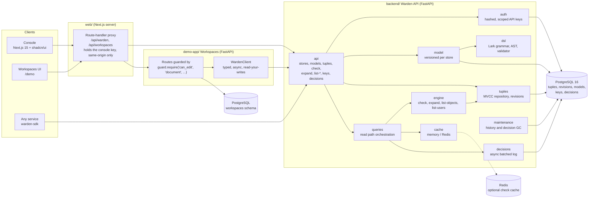
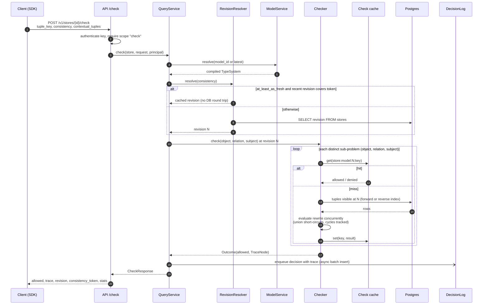
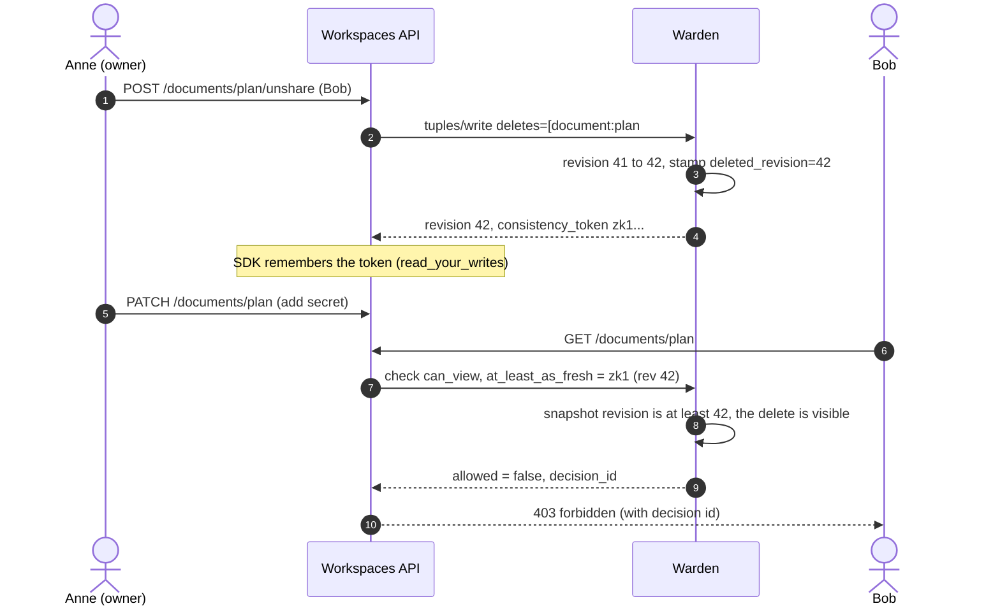
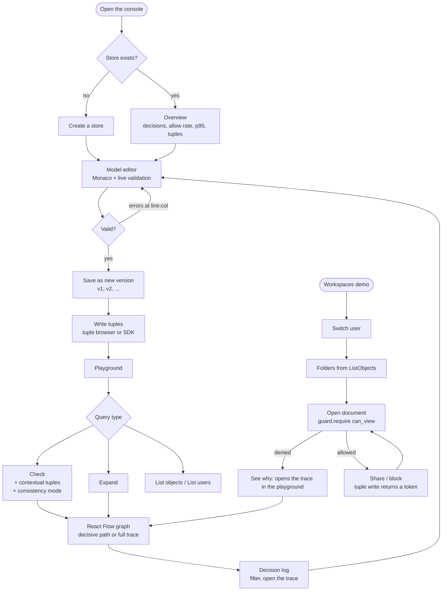
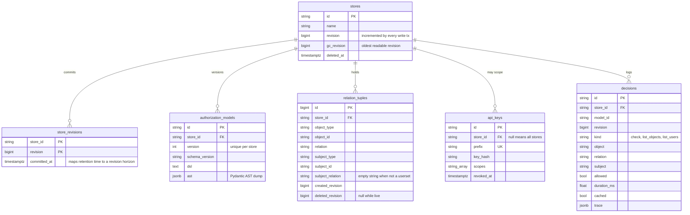

# Architecture

How Warden is put together and how a request flows through it. The
[README](../README.md) has the short version.

## Components

## Read path

`check(request, consistency)` resolves a snapshot revision, then goes through the cache, evaluation and trace, and finally the decision log:

## Closing the new-enemy window

The classic Zanzibar failure: Alice removes Bob from a document, then adds a secret to it. A
stale read could still let Bob see the new content. Warden avoids this by returning a token
from every write and accepting it on later reads.

## User flow

## Data model

Indexes on `relation_tuples`:

| Index | Columns | Purpose |
|---|---|---|
| `uq_relation_tuples_live` | full key, `WHERE deleted_revision IS NULL` | at most one live copy of a tuple |
| `ix_relation_tuples_forward` | `store, object_type, object_id, relation` INCLUDE subject + revisions | "who has `relation` on `object`" (index-only scans) |
| `ix_relation_tuples_reverse` | `store, subject_type, subject_id, subject_relation, object_type, relation` INCLUDE object_id + revisions | ListObjects reverse walk |
| `ix_relation_tuples_created` / `_deleted` | `store, created_revision` / `store, deleted_revision` | change feed and garbage collection |

## How a check is answered

The checker in [`engine/check.py`](../backend/src/warden/engine/check.py) treats each
`(object, relation, subject)` triple as a sub-problem:

1. **Memoize and share.** A sub-problem is resolved at most once per pass. If two branches need
   it, the second one waits on the first one's task, so graphs with diamonds cost time linear in
   the number of sub-problems rather than the number of paths.
2. **Run concurrently and short-circuit.** Children of a union or intersection run as `asyncio`
   tasks. A union returns on the first grant and an intersection on the first denial. Sibling
   work that nothing else waits on is cancelled.
3. **Detect cycles without deadlocks.** Waiting on shared in-flight work can deadlock when the
   relationships form a cycle (`team:a#member` contains `team:b#member`, which contains `team:a#member`). The evaluator
   keeps a wait-for graph. A request that would close a cycle is answered from an assumption
   (initially "denied") and the edge is marked.
4. **Iterate to a fixpoint.** If an assumption turns out wrong, the pass is repeated with the
   corrected assumptions. This is Kleene iteration from the bottom element. For monotone rewrites
   it converges to the least fixpoint, the answer a naive bottom-up evaluation would give. A cycle
   through the subtracted side of an exclusion, which is not monotone, fails with a clear error
   instead of looping.
5. **Bound the work.** `WARDEN_MAX_CHECK_DEPTH` limits recursion and `WARDEN_QUERY_DEADLINE_MS`
   limits wall-clock time. Both return typed errors.

The property tests compare `check`, `expand` and `list_objects` on random models and tuple sets
with an independent least-fixpoint oracle, so the cycle handling is tested, not just argued.

## Design decisions and trade-offs

| Decision | Why | Cost |
|---|---|---|
| **Revision counter per store**, tuples stamped with created/deleted revisions | Snapshot reads become a plain `WHERE created_revision <= N AND (deleted_revision IS NULL OR deleted_revision > N)`. There are no long transactions, and any retained revision can be read and cached. | Each write transaction takes a row lock on its store, so writes to one store are serialized. That is fine for authorization workloads, where reads dominate. |
| **Revision quantization** (`minimize_latency` reuses a revision for up to 2 s) | Concurrent checks land on the same revision and share cache entries, as in Zanzibar's quantized snapshots. | Results can be up to that long out of date unless the caller sends a token. The SDK sends its last write token automatically. |
| **Cache keyed by `store:model:revision`** | Data at a revision never changes, so there is nothing to invalidate. TTL and LRU only bound memory. | A new revision starts with a cold cache. Quantization keeps revisions from changing on every request. |
| **History retention plus GC** | Deleted tuples remain readable for `WARDEN_TUPLE_HISTORY_RETENTION_HOURS`. GC turns that window into a revision horizon and drops older history. | Tokens older than the horizon fail with `snapshot_too_old` instead of returning a silently wrong answer. |
| **ListObjects = reverse walk + confirm** | The reverse walk over the `subject` index produces a candidate superset cheaply. Intersections and exclusions are then decided by real checks that share one memo table. | Very broad relations (for example `user:*` on many objects) can hit `WARDEN_LIST_MAX_CANDIDATES`. The response then says `truncated: true`. |
| **Contextual tuples bypass the shared cache** | They change the answer without changing the revision. | Checks that use contextual tuples always evaluate. |
| **Async, batched decision log** | Logging stays off the hot path. Traces are pruned to `WARDEN_DECISION_TRACE_MAX_NODES`. | A crash can lose the last unflushed batch (at most about 500 ms). Set `WARDEN_DECISION_LOG=sync` if every decision must be durable. |
| **Frozen Pydantic AST, positions excluded from equality** | A compiled model can be shared safely across concurrent checks. Formatting is a fixed point (property-tested). | Slightly more ceremony than plain dataclasses. |
| **Console proxies the API with its own key** | The browser never holds a Warden key. The console key has every scope except `keys:admin`, and the proxy rejects cross-site and non-JSON requests. | Set `CONSOLE_BASIC_AUTH` whenever the console is reachable from anywhere but localhost. |
